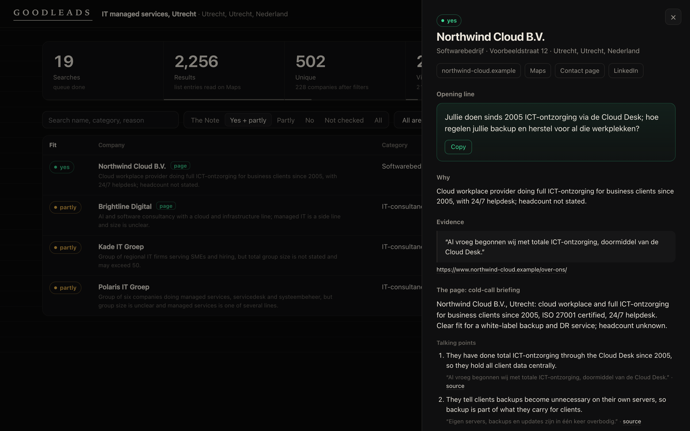

# GOODLEADS

**The Death Note for sales. Every name in it closes.**

*Every company on the map. A briefing for the ones worth calling.*



<sub>The local page after a small test run. Company names, addresses and phone numbers in this picture are replaced
with made-up ones.</sub>

Most lead lists are a phone book. GOODLEADS is a notebook: it reads every company in your niche on the map, and only
the ones that truly fit get written in, each with the evidence, the opening line and a one-page call briefing.

GOODLEADS builds the most complete prospect list you can get for one B2B niche in one area, then tells you which of
those companies are worth a call, why, and how to open the conversation. It sweeps Google Maps cell by cell (so a
busy city centre doesn't get cut off at Maps' 120-result limit), drops the duplicates, reads each company's own
website, and then Claude Code checks every company against your criteria with a quote as proof.

It works for any niche in any country: IT service providers in Utrecht, accountants in Ghent, machine shops in Ohio.
It only finds and qualifies. It does not send e-mail, it does not call, and it never collects e-mail addresses.

```
find      Google Maps, cell by cell      →  every listing in the area, deduplicated
visit     each company's own website     →  what they do, jobs, size, contact page
qualify   Claude Code, two steps         →  fit yes / partly / no, a quote as evidence, one opening line
brief     Claude Code, best fits only    →  a cold-call briefing per company
npm start a local page                   →  funnel, filters, company cards, CSV export
```

## What you need

- [Claude Code](https://claude.com/claude-code). Your Claude plan covers the qualifying; no API key.
- Python 3.10 or newer, for finding and visiting.
- [Node.js](https://nodejs.org) 20 or newer, for the local page. Nothing to install beyond that.
- Mac, Windows or Linux.

## Setup

Mac and Linux:

```bash
git clone https://github.com/Julianmakesmoney/goodleads.git && cd goodleads
python3 -m venv .venv
.venv/bin/pip install -r requirements.txt
.venv/bin/python -m playwright install chromium
claude
```

Windows (PowerShell):

```powershell
git clone https://github.com/Julianmakesmoney/goodleads.git; cd goodleads
py -m venv .venv
.venv\Scripts\pip install -r requirements.txt
.venv\Scripts\python -m playwright install chromium
claude
```

`npm start` needs nothing installed: the page has no dependencies. To check the install, run the tests:
`.venv/bin/pip install pytest` and `.venv/bin/python -m pytest -q` (Windows: `.venv\Scripts\...`).
Or open Claude Code anywhere and say: "Clone github.com/Julianmakesmoney/goodleads and set it up for me."

## Run it

1. **`/goodleads-setup`** in Claude Code. Two ways in (see *Setup: tell it exactly who you want* below): paste one
   long description and Claude only asks what's missing, or answer a short interview, one question at a time. It
   writes `config/niche.json` and `config/criteria.md`.
2. **`python run.py find`** sweeps Google Maps. It shows live how many searches, results and unique companies it has.
   It is slow on purpose (see *Google and the pace* below); stop it with Ctrl+C whenever you like and run it again
   to continue where it left off. `python run.py plan` shows the size of the job first.
3. **`python run.py visit`** reads each company's own website: what they sell or do, open jobs, size signals, the
   contact page.
4. **`/goodleads-calibrate`** in Claude Code (recommended, about 2 minutes). Claude judges 10 of the visited
   companies and shows one line each; you say "right" or "wrong, because ...". Every correction becomes a rule in
   your criteria. Up to 3 rounds, until you agree with it.
5. **`/goodleads-qualify`** in Claude Code. It shows how many companies and the estimated tokens and waits for your
   OK. Then a quick sieve on a small model drops what clearly doesn't fit, and a deeper check on a better model
   labels the rest: **fit** (yes, partly, no), a **score** (0-100) that ranks the fits, the **reason**, a
   **verbatim quote** from their site as evidence, and **one opening line** built on the most specific true detail
   it found. Must-haves and deal-breakers count hard; nice-to-haves and buying signals decide the order.
6. **`/goodleads-brief`** in Claude Code (optional). For every **fit = yes** company, best score first, a sub-agent
   does a short deep research (their own site and recent news) and writes a **cold-call briefing**: who they are
   and why now, **who to ask for**, the goal of the call, 3 talking points with evidence, the opener, 2 likely
   objections with answers, and what to ask. It shows the cost
   first; `max_brief` (default 25) caps it. Briefings land in `data/briefings/<id>-<name>.md`, on the company card
   and in the CSV. Partly-fits keep their short qualification.
7. **`npm start`** and open http://localhost:4760. A funnel on top (searches → results → unique → visited → fit),
   a table you can filter by fit, area, size and hiring (best first), a card per company with the evidence, the
   criteria it meets and the opening line, and **Export CSV** for calling, LinkedIn or your CRM.
   `python run.py export` writes the same CSV, ranked.

Use `.venv/bin/python` (Windows: `.venv\Scripts\python`) in place of `python` if you set up the virtual environment
as above. In Claude Code, add `--yes` to `/goodleads-qualify` or `/goodleads-brief` to skip the OK question (for
headless runs such as `claude -p "/goodleads-qualify --yes"`); the estimate is still shown.

## An example run

These are the real totals of the engine GOODLEADS was extracted from: Julian Verboom's own prospecting engine,
run for one niche (technical wholesalers in hydraulics, pneumatics and drive technology) across the Netherlands and
Flanders.

| Step | Count |
|---|---|
| Google Maps searches | 2,321 |
| Results read from the lists | 171,558 |
| Unique companies | 13,560 |
| Screened by AI (the sieve) | 12,116 |
| Deep-checked | 2,416 |
| **Perfect fit** | **650** (plus 687 partial) |

Every one of the 650 came with the reason, a quote from its own site, and an opening line. Those numbers are from
that engine, not from a GOODLEADS run; GOODLEADS is the same method, made general for any niche and country.

A small smoke test of GOODLEADS itself, "IT managed service provider" in the city of Utrecht with the test pace
(14 searches, then 8 minutes rest): 19 searches in 17 minutes, 2,256 results, 502 unique listings, 228 companies
inside the city after filters and de-duplication, 217 readable websites. Of 15 companies sent through
`/goodleads-qualify`, the sieve kept 8; the deep check marked 1 yes, 3 partly and 4 no (three of those were IT firms
of 250+ people, a deal-breaker), with every evidence quote found on the stored pages. A second smoke test, "accountant" and
"boekhouder" in Ghent (30 searches, stopped there on purpose with 14 left in the queue): 3,609 results, 534 unique
listings, 210 companies (70 of them without a website, let in by a filter bug that has since been fixed),
128 readable websites, in 27 minutes, without a single block from Google.

## Setup: tell it exactly who you want

GOODLEADS is only as precise as your criteria. `/goodleads-setup` writes them with you, in one of two ways.

**One prompt.** Paste everything at once after the command: `/goodleads-setup <your description>`. Claude pulls out
your offer, price, ideal customer, best clients, deal-breakers, buying signals, the person you want to speak to and
the area, shows one short "This is what I understood", and only asks what's missing or contradicts itself.
[`examples/setup-prompt.md`](examples/setup-prompt.md) has a **template to fill in**, and a **ready-made prompt for
ChatGPT or Claude** that writes that description from your website in a minute.

**The interview.** Without a description, Claude asks one question at a time, with examples, and skips what it
already knows:

1. What you sell, and roughly what it costs (so it can judge who can afford it).
2. Your ideal customer.
3. 2 or 3 of your best clients. Claude reads their websites (`python run.py lookalike <url> ...`), tells you what
   they have in common, and asks whether that is what makes them good.
4. 1 or 2 bad fits, and why.
5. Must-haves versus nice-to-haves (Claude proposes the split and the weights; you adjust).
6. Deal-breakers.
7. Buying signals: hiring for a role, a new office, growth, software or brands they name, recent news.
8. Who you want to speak to (used by the briefing: "ask for ...").
9. What a good first call looks like (used for the opener and the objections).
10. The area, then the search terms in that country's language.

The result is `config/criteria.md` in a fixed outline: **Offer, Price, Ideal customer, Lookalikes from best
clients, Must-haves, Nice-to-haves, Deal-breakers, Buying signals, Who to ask for, What a good first call looks
like, Assumptions, Learned from calibration**. Items are numbered so the AI can name them and GOODLEADS can count
them:

```markdown
## Must-haves
- M1: Runs IT for other businesses on an ongoing contract.
## Nice-to-haves
- N1 (weight 3): Offers or mentions backup already.
## Deal-breakers
- D1: Computer or phone repair shops for consumers.
## Buying signals
- S1 (weight 3): Hiring for the service desk.
```

How they count: a deal-breaker or a must-have the site contradicts makes a company **no**; a must-have the site
doesn't show turns a **yes** into **partly**; the nice-to-haves and buying signals it shows give the **score**
(their weights, as a share of 100) that puts the best fits on top. `python run.py criteria-check` checks the file.
See [`examples/criteria.md`](examples/criteria.md) for a complete one; edit it whenever you learn something.

## Calibration: check it on 10 companies first

Before you spend tokens on hundreds of companies, `/goodleads-calibrate` checks the criteria on about 10 you already
visited: a mix of likely yes, likely partly and likely no. Claude judges them and shows one line each:

```
3. Example IT (example-it.nl) | id 42 | YES 67 | Managed IT for care homes on a monthly contract, hiring.
4. Sample Web (sample-web.nl) | id 57 | NO | Web design agency, no IT management. [D2: Web design, ...]
```

You answer per company "right" or "wrong, because ...". Claude turns each correction into a rule a website can
show ("a company whose only IT service is hosting is not a fit") and, after your OK, adds it to *Learned from
calibration* (`python run.py learn "..."`). The next round re-judges the ones that were wrong plus a few new ones;
at most 3 rounds. Calibration stores no labels, and costs about one deep batch (~110k tokens) per round. Setup
offers it at the end when there are visited companies; after big changes, `/goodleads-qualify --again` judges
everything again.

## Cost and time

- **Finding** costs nothing but time. Google tends to block after a fixed number of searches in a row, so GOODLEADS
  works in blocks (12 searches by default) with a rest in between (20 minutes by default), and adjusts the block
  size itself when it meets a block. That makes it about 30 searches an hour. A city with one or two search terms
  takes an hour or two; a whole country can take days in the background. `python run.py plan` tells you before you
  start.
- **Visiting** websites is fast: a few minutes per 200 companies.
- **Qualifying** uses your Claude plan, no API key. GOODLEADS keeps it cheap: the AI never reads raw site text.
  `run.py` first labels what needs no AI (parked domains, unreachable sites, your `sieve_drop_words`), then cuts each
  site into sentences, drops menus and repeated boilerplate, and keeps only the opening of the home and about page
  plus the sentences that contain your `keywords`. Measured on the Utrecht test data (each figure is one sub-agent
  run as Claude Code reports it):

  | Step | Before | Now |
  |---|---|---|
  | Sieve (Haiku) | ~90,000 tokens for 15 companies (~6,000 each) | ~105,000 for 80 companies (~1,300 each) |
  | Deep check (Sonnet) | ~140,000 for 8 companies (~17,500 each) | ~109,000 for 20 companies (~5,400 each) |
  | Briefing (Sonnet + web) | ~90,000 for 1 company | ~95,000 for 4 companies (~24,000 each) |

  About 80,000 of every sub-agent run is fixed overhead, so full batches are the cheap ones. On the same companies
  the new deep check agreed with the old one on 7 of 8 labels, and every evidence quote was found on the stored
  pages. `/goodleads-qualify` shows the estimate and waits for your OK, and `max_qualify` in `config/niche.json`
  (default 300) caps how many companies get checked. 300 companies come to roughly 0.4M (sieve) + 0.9M (deep)
  tokens.
- **Briefings** do one round of web research per company (one news search, at most one extra page of their own
  site). `/goodleads-brief` shows the estimate first; `max_brief` (default 25) caps it.

## Google and the pace (read this)

Google's Terms of Service do not allow automated reading of Google Maps. GOODLEADS does it anyway, the way a person
would at a calm pace: one browser, one search at a time, pauses between searches, long rests between blocks, and a
full stop when Google pushes back. **Use it at your own responsibility.** Keep the default pace, don't run several
at once, and expect that Google may still block you for a while (GOODLEADS pauses and continues later; nothing is
lost).

GOODLEADS keeps **business data only**: company name, category, business address, business phone, website, rating
and review count from the Maps listing, and text from the company's own website. It does not open review pages,
does not store reviews or reviewer names, and **removes e-mail addresses** from everything it stores. Briefings
may name decision makers, but only with the name and role the company publishes on its own website. What you then
do with the list (calling, messaging) is subject to the rules for B2B outreach where you are, such as the GDPR in
Europe.

## How it works

- **The grid.** Each area you name is looked up on OpenStreetMap (free, no key), which gives its outline. GOODLEADS
  covers the outline with square cells (a third of the area's longest side, between 3 and 20 km) and searches every
  term in every cell. When a list comes back full and the cell itself is busy, the cell is split into four smaller
  cells one zoom level deeper, up to `max_depth` times. Companies outside the outline are dropped.
- **Duplicates.** One listing can show up in many searches: it is stored once (Maps id). Listings that share a
  website become one company, and listings with the same phone number within 50 metres are merged.
- **The filter.** `category_exclude` drops Maps categories that are certainly wrong (a word in the company name from
  `name_keywords` overrules it). Companies without a website are left out unless you set `keep_without_website`.
- **Resume.** Every search is a row in a local SQLite database (`data/goodleads.db`). Stop at any point; `find`
  continues with what's left, and the learned pace is kept in `data/pace.json`.
- **Qualifying.** `run.py qualify-prep` writes compact text batches to `data/qualify/` (criteria on top, then a
  line or a short block per company with only the sentences that matter); Claude Code's sub-agents
  (`.claude/agents/goodleads-sieve.md` on Haiku, `.claude/agents/goodleads-qualifier.md` on Sonnet) write labels next to
  them; `run.py import-labels` applies the hard rules, computes the score, stores the labels and checks every
  evidence quote against the stored pages. Each step reads only the criteria sections it needs (the sieve gets
  offer, ideal customer, must-haves, deal-breakers and learned rules). A quote it
  can't find is marked on the card. `/goodleads-brief` works the same way with `run.py brief-prep` and the
  `goodleads-briefer` sub-agent.
- **The page** is a zero-dependency Node server that asks `run.py json` for the data.

## What's inside

| Path | What |
|---|---|
| `run.py` | The command line: `plan`, `find`, `visit`, `status`, `export`, `criteria-check`, `lookalike`, `calibrate-prep`, `calibrate-show`, `learn`, `qualify-prep`, `brief-prep`, `import-labels` |
| `goodleads/` | Maps search and grid, website visits and signals, qualifying, reports |
| `.claude/commands/` | `/goodleads-setup`, `/goodleads-calibrate`, `/goodleads-qualify` and `/goodleads-brief` |
| `.claude/agents/` | The sieve, qualifier and briefer sub-agents |
| `app/` | The local page (Node 20, no dependencies) |
| `examples/` | A complete `niche.json` and `criteria.md`, and `setup-prompt.md` (template and AI prompt) |
| `tests/` | Unit tests: `pip install pytest`, then `python -m pytest -q` |
| `config/`, `data/` | Your niche and your data (kept out of git) |

## Settings

Everything lives in `config/niche.json`; see [`examples/niche.json`](examples/niche.json).

| Key | Default | What |
|---|---|---|
| `country`, `language` | | ISO country code and the Maps interface language (`hl`) for that country |
| `areas` | | OpenStreetMap names: `"Utrecht, Utrecht, Nederland"`, `"Belgium"`, `"Greater Manchester"` |
| `search_terms` | | Maps categories and words, in the country's language |
| `category_exclude`, `name_keywords` | `[]` | The category filter and its override |
| `keywords` | `[]` | Word stems in the sites' language; they pick the sentences the AI reads. `/goodleads-setup` writes them, and `/goodleads-qualify` adds them when missing |
| `sieve_drop_words` | `[]` | A word in a company name or Maps category that means a certain "no", dropped without AI |
| `keep_without_website` | `false` | Keep companies that have no website |
| `grid.cell_km` | `"auto"` | Cell size in km, or `auto` |
| `grid.max_depth` | `3` | How often a busy cell may be split |
| `pace.block`, `pace.rest_minutes` | `12`, `20` | Searches per work block, minutes of rest |
| `max_qualify` | `300` | Most companies to qualify |
| `max_brief` | `25` | Most cold-call briefings per `/goodleads-brief` |

`GOODLEADS_CONFIG` and `GOODLEADS_DATA` (or `--config` and `--data`) let you keep several projects side by side.

## Credits

Built by Julian Verboom ([Viral Conversions](https://viralconversions.io)). MIT licensed; see `LICENSE`.
